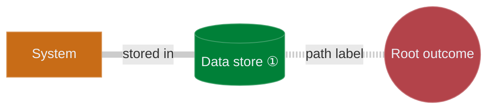

# Attack Path Map

Turn a root outcome and its attack paths into a `.md` file the user can commit to GitHub (it renders as a Mermaid diagram) or open in the APME editor to refine.

## Gather requirements

You need:
1. **Root**: the unwanted outcome, e.g. "Customer data stolen" or "Production outage".
2. **Attack paths**: the main branches, e.g. "Customer database", "CI/CD pipeline secrets", "Shared file storage".
3. **Depth**: 2 or 3 levels is typical: asset or access path, then the system or config behind it, then the actor.
4. **Notes**: any nodes that need explanatory text.

If the user has given enough context, build first and ask about gaps afterwards.

## Nodes

- **IDs**: `n1` for the root, then `n2`, `n3`, ... in order. Use only letters, digits, `_` and `-`, and never reuse an ID.
- **One root**, always a circle: `n1(("label"))`.
- **Labels**: a few words each. The editor cuts any label longer than 1,000 characters.
- Every node gets a `style` line: `style nX fill:<fill>,stroke:<stroke>,color:#ecf0f6`.

| Role | Shape | Fill / Stroke | Use for |
|------|-------|---------------|---------|
| Root (unwanted outcome) | `nX(("label"))` | `#b3434a` / `#c67277` | The outcome being prevented. Exactly one. |
| Data store | `nX[("label")]` | `#008038` / `#40a06a` | Databases, key stores, backups, credential vaults |
| System / config | `nX["label"]` | `#c86c17` / `#d69151` | Software, services, configuration files |
| Access path | `nX["label"]` | `#c4a81a` / `#d3be53` | Pipelines, shared drives, portals, network paths |
| Internal actor | `nX["label"]` | `#156dbc` / `#5092cd` | Employees, admins, privileged users |
| External actor | `nX["label"]` | `#6a737d` / `#8f969e` | Attackers, vendors, contractors, supply chain |

## Escaping (required)

Inside every quoted string (node labels, edge labels and `click` tooltips), write these characters as follows. Escape the original text once; don't escape the escapes.

| Character | Write |
|-----------|-------|
| `"` | `#quot;` |
| `#` | `#35;` |
| `&` | `&amp;` |
| `<` | `&lt;` |
| `>` | `&gt;` |
| line break | `<br/>` |

So the label `Admin "break-glass" account` becomes `n8["Admin #quot;break-glass#quot; account"]`. A raw `"` inside a label makes Mermaid reject the whole diagram, so nothing renders on GitHub.

## Edges

- **Write every edge parent first**: the node nearer the root goes on the left (`n1 -.- n2`, then `n2 --- n5`). The editor works out each node's depth from edge direction, so a reversed edge lands at the wrong depth.
- **Dotted** `-.-` or `-.-|"label"|`: the attack path itself, typically the edges leading out from the root.
- **Solid** `---` or `---|"label"|`: named relationships such as "stored in", "hardcoded in", "accessed via".
- After the last edge, add `linkStyle default stroke:#cccccc,stroke-width:7.5px;`

## APM-DATA line

Put this immediately after the `%%{init: ...}%%` line. Mermaid ignores `%%` lines; the editor reads this one.

```
%% APM-DATA: {"v":1,"dir":"RL","master":"n1","notes":{"n2":"Note text"}}
```

- It must be **one line of valid JSON**: escape `"` and `\` in note text as `\"` and `\\`, and write line breaks as `\n`.
- `master`: the root's ID.
- `notes`: only the nodes that have a note.
- **Leave out `pos` and `bends`.** The editor lays the map out itself, sized to the labels and without overlaps. Hand-placed positions overlap wherever labels are wide, and they pin every node so the layout stops re-flowing. GitHub ignores positions anyway.

## Notes

For each node with a note:
1. Append its marker to the label: ① for the first noted node, then ② and so on up to ⑳, then `(21)`, `(22)`. Example: `n2[("Customer database ①")]`.
2. Add the note text to `notes` in the APM-DATA line. This is what the editor shows on hover.
3. Add a click line, using the escaped label without its marker: `click n2 "#note-n2" "Customer database"`.
4. Add an entry under `## Notes` after the diagram. This is what readers see on GitHub. The note text there is Markdown, so keep it to plain sentences or backslash-escape `` * _ ` [ ] < > # ``.

## Output file

Save as `<descriptive-name>-apm.md` in the user's project:

````markdown
# Attack Path Map



## Notes

<a id="note-n2"></a>
**① Data store**

Note text.
````

## Worked example

`example.md`, next to this file, is a complete map: 10 nodes over 3 branches, 2 notes, and one label with escaped quotes. Follow its structure.

## Before you finish

- Exactly one circle root, and its ID is `master`.
- Every node has a `style` line.
- Every quoted string is escaped; no raw `"` inside any label.
- Every edge is written parent first.
- The APM-DATA line is one line of valid JSON, without `pos` or `bends`.
- Every note has its marker, its APM-DATA entry, its click line and its `## Notes` entry, with matching numbers.

Then tell the user they can open the file at https://tomituominen.github.io/APME/ to refine it; the editor lays it out on load.
